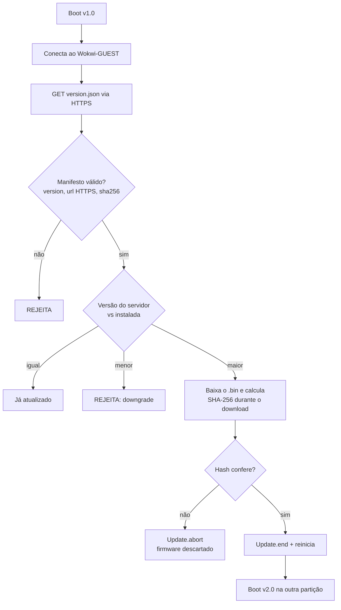

# Atualização remota de firmware (OTA) segura no ESP32

CP3 de Hardware Hacking (FIAP). Um ESP32 simulado no **Wokwi** começa na versão **1.0**, consulta um manifesto (`version.json`) via HTTPS, baixa a versão **2.0**, confere o **SHA-256** e só então instala o firmware. Em seguida, cinco testes mostram que o processo também **rejeita** atualizações indevidas.

**Prova visual:** a v1.0 pisca o LED a cada 1 s e a v2.0 pisca a cada 150 ms.

## Estrutura

```
esp32-ota-seguro/
├── sketch/
│   ├── sketch.ino        # código do ESP32 (cole no Wokwi)
│   ├── diagram.json      # ESP32 + LED no GPIO 2
│   └── libraries.txt     # ArduinoJson
├── servidor/             # o GitHub funciona como servidor de atualização
│   ├── version.json                 # manifesto real (v2.0 + SHA-256)
│   ├── teste_hash_adulterado.json   # T3: hash errado
│   ├── teste_url_invalida.json      # T4: firmware inexistente
│   └── teste_downgrade.json         # T5: tenta instalar a v0.9
└── firmware/
    └── firmware_v2.bin   # firmware 2.0 compilado
```

## Fluxo de atualização



## Controles de segurança implementados

| Risco | Controle no código |
|---|---|
| Firmware alterado no caminho ou no servidor | SHA-256 calculado durante o download e comparado com o manifesto. Se não bater, `Update.abort()` descarta a partição. |
| Instalar uma versão antiga e vulnerável | Anti-rollback: versão menor que a instalada é recusada. |
| Interceptação da comunicação | Manifesto e firmware só por HTTPS. URL `http://` é recusada. |
| Manifesto malformado ou incompleto | Validação de `version`, `url` e `sha256` (64 caracteres) antes de qualquer download. |
| Dispositivo inutilizado por falha | O firmware novo é gravado na partição OTA livre. A versão atual só é trocada depois que tudo é validado. |

**Limitações conhecidas (para um cenário real):**
- O lab usa `setInsecure()`, ou seja, não valida o certificado do servidor. Em produção, seria `setCACert()` com a CA raiz.
- O hash garante **integridade**, mas não **autenticidade**: quem controla o servidor pode trocar o arquivo e o hash juntos. A solução é **assinatura digital** (ECDSA) e **Secure Boot** do ESP32.

## Testes realizados

| # | Teste | Como executar | Resultado esperado |
|---|---|---|---|
| T1 | Atualização normal 1.0 → 2.0 | `MANIFESTO "version.json"` | Hash confere, firmware instalado, reinicia |
| T2 | Já atualizado | Acontece sozinho após o T1 | v2.0 lê o manifesto e não faz nada |
| T3 | Firmware adulterado | `MANIFESTO "teste_hash_adulterado.json"` | `REJEITADO: hash diferente`, continua em 1.0 |
| T4 | Firmware inexistente | `MANIFESTO "teste_url_invalida.json"` | `HTTP 404`, atualização cancelada |
| T5 | Downgrade | `MANIFESTO "teste_downgrade.json"` | `DOWNGRADE bloqueado`, continua em 1.0 |

### Evidências

> Cole aqui os prints do Monitor Serial de cada teste.

**T1 e T2:** _[print do log 1.0 → download → hash confere → reinício → boot 2.0 + "já está atualizado"]_

**T3:** _[print]_

**T4:** _[print]_

**T5:** _[print]_

## Como reproduzir

1. Abra [wokwi.com](https://wokwi.com), crie um projeto **ESP32 (Arduino)** e substitua `sketch.ino`, `diagram.json` e `libraries.txt` pelos arquivos da pasta `sketch/`.
2. Clique em ▶ e acompanhe o Monitor Serial.
3. Para os testes T3 a T5, troque o valor de `MANIFESTO` no código e rode de novo.
